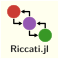

<p align="center">
  
</p>

<p align="center">
    <a href="https://koiralabs.github.io/Riccati.jl/dev/"></a>
    <a href="https://github.com/invenia/BlueStyle"></a>
    <a href="https://github.com/koiralabs/Riccati.jl/actions/workflows/CI.yml?query=branch%3Amain"></a>
</p>

---

**Riccati** is a lightweight [Julia](https://julialang.org/) package for formulating and solving optimal control problems at high frequencies by exploring their recursive structure. It is focused on linear-quadratic problems arising from nonlinear receding-horizon control.

## Installation

This package is currently not in the official registry. In order to use **Riccati.jl**, you can add this repository directly:

```julia
using Pkg; Pkg.add(url="https://github.com/KoiraLabs/Riccati.jl")
```

or by entering `]add https://github.com/KoiraLabs/Riccati.jl` in the Julia REPL. 

> [!WARNING]
> This package is under active development. A stable version will be released soon.
